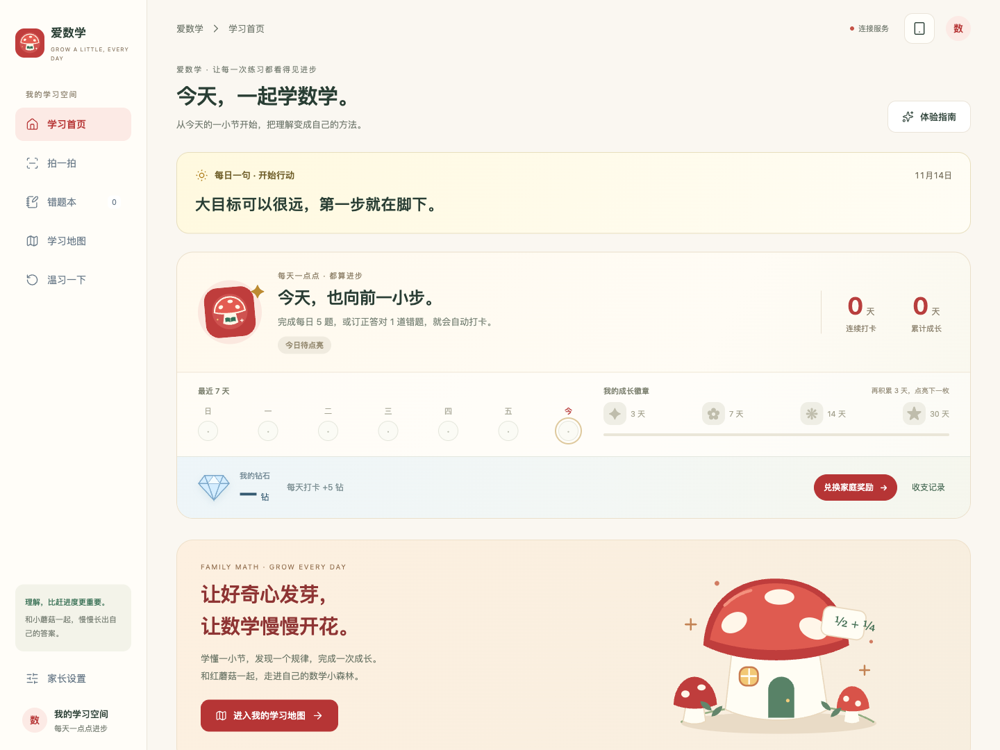

# Family Math · 爱数学

**Turn a difficult question into something a child can solve independently.**

A self-hosted AI math learning companion for families and iPad. One application, one launch command, one learning space.

[中文介绍](README.md) · [Deployment](docs/DEPLOYMENT.md) · [Architecture](docs/ARCHITECTURE.md)



## Features

- Photo homework grading, per-question answers and mistake collection.
- Original-question practice, multi-part answers and step-by-step explanations.
- Knowledge map, local practice bank and a fixed daily five-question review.
- Apple Pencil scratchpad, A4 print preview, automatic pagination and recycle-bin recovery.
- Daily check-in animations, diamonds and parent-approved family rewards.
- Private self-hosted storage, backups and device synchronization.

## Quick start

Python 3.10 or newer:

```bash
git clone https://github.com/leowang0829/family-math.git
cd family-math
python3 -m venv .venv
source .venv/bin/activate
pip install -r requirements.txt
python run.py
```

Open http://127.0.0.1:8921/ . Configure your own Alibaba Cloud API key at http://127.0.0.1:8921/setup on the host computer. The default private data directory is `.local/math`.

Alternatively, copy `.env.example` to `.env`, configure your key and run `docker compose up -d --build`.

## Models and privacy

The existing Max＋Flash routing is retained. AI requests are billed to your provider account. Local practice, check-ins and reward bookkeeping do not call paid models. Photo processing sends images to the configured provider. Keys and learning data stay outside the source repository.

Use HTTPS, a strong family password and a reverse proxy for public access. No accuracy or fixed-latency guarantee is made. Review deployment and release notes before use; Docker and physical-device coverage are explicitly documented.

MIT-licensed project code. Third-party assets retain their original licenses. Contributions and privacy-safe synthetic examples are welcome.
