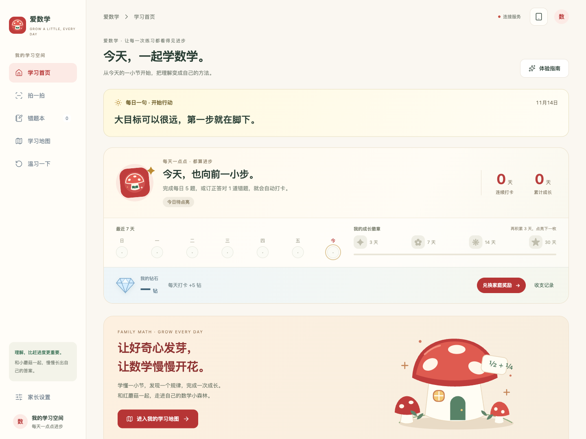
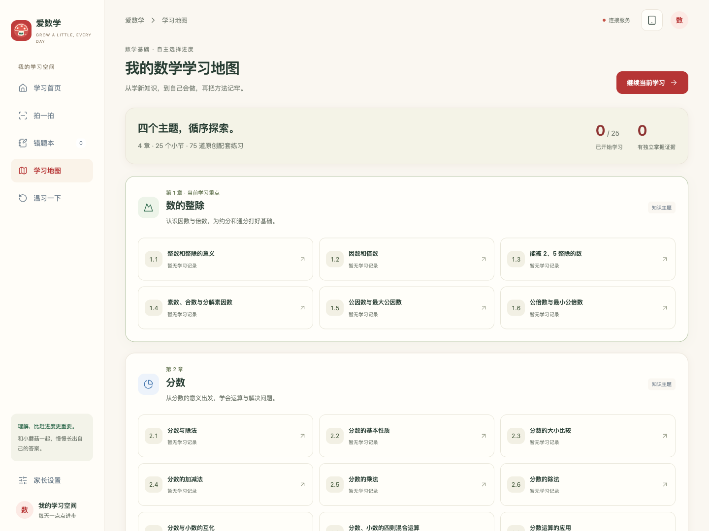

<div align="center">


# 爱数学 · Family Math

**拍下不懂的题，练到自己会做。**

面向家庭与 iPad 的自托管 AI 数学学习助手

[](https://github.com/leowang0829/family-math/actions/workflows/checks.yml)
[](LICENSE)
[](https://www.python.org/)
[](docs/GETTING_STARTED.md)

[快速开始](#快速开始) · [功能介绍](#功能介绍) · [部署指南](docs/DEPLOYMENT.md) · [常见问题](docs/FAQ.md) · [English](README.en.md)
</div>



## 为什么做爱数学

听懂了一道题，不等于下一次能独立做对。爱数学把拍题、错题整理、原题重做、分步讲解、每日温习和纸笔练习接在一起，让孩子有清楚的下一步，也让家长少花时间整理照片。

一个名称，一个安装入口，一个学习空间。学习地图按知识点组织，使用者可以选择自己的学习进度。

## 功能介绍

| 入口 | 你可以做什么 |
|---|---|
| 学习首页 | 查看今日温习、学习进度、每日一句、打卡和钻石奖励 |
| 拍一拍 | 拍照或从相册导入作业，识别题目与作答，查看逐题批改和参考答案 |
| 错题本 | 收纳老师标错、AI 判错和不会做的题；先重做原题，再看分步讲解 |
| 学习地图 | 按数学知识点阅读知识卡、看例题、做练习并关联错题 |
| 温习一下 | 每日固定五题，优先练未做过的变式，再巩固已学知识 |
| 家长设置 | 配置学习进度、查看连接、管理钻石奖励和家庭兑换 |

练习支持多小问答题卡、分数输入、Apple Pencil / 手指手写草稿。原题做对一次显示已掌握，衍生题继续在温习中巩固。误删题目可从回收站恢复，也可以批量恢复。

打印遵循“选题 → 预览 → 打印”，准备干净题面、按 A4 自动分页并留出作答空间。复杂图形的重建效果需要核对预览。



## 快速开始

需要 Python 3.10 或更新版本。

```bash
git clone https://github.com/leowang0829/family-math.git
cd family-math
python3 -m venv .venv
source .venv/bin/activate
pip install -r requirements.txt
python run.py
```

打开 **http://127.0.0.1:8921/**。在运行后台的电脑打开 **http://127.0.0.1:8921/setup**，填写自己的阿里云百炼密钥，并用家庭连接码连接学习空间。

默认私有数据目录为 `.local/math`。未配置密钥也能查看界面、阅读知识卡和使用本地练习；真实照片识别、AI 讲解和打印清题需要模型服务及可用额度。

### Docker

```bash
cp .env.example .env
# 在 .env 填写自己的 DASHSCOPE_API_KEY
docker compose up -d --build
```

一个服务，一个端口，一个独立数据卷。Docker 配置的实测范围见 [发布说明](docs/RELEASE_NOTES.md)。

## 在 iPad 上使用

用 Safari 打开能够访问后台的地址，连接家庭学习空间，再选择“分享 → 添加到主屏幕”。局域网使用和云端 HTTPS 配置见 [使用指南](docs/GETTING_STARTED.md) 与 [部署指南](docs/DEPLOYMENT.md)。后台需要持续运行，相机、PWA 和打印支持取决于设备与浏览器版本。

## 模型、速度与费用

默认保留 Qwen3.8-Max＋Flash 分工：Max 用于主要批改、复杂题复核、讲解和打印题面重建，Flash 辅助识别与衍生练习。使用自己的百炼账户，按厂商实际用量计费。

知识卡、本地规则题库、每日打卡和钻石记账不调用付费模型。一张照片可能触发多次模型请求；题数、图片质量、重试与打印会影响时间和费用。应用内金额是估算值，结算以厂商账单为准。项目不承诺固定月费、秒级完成或百分之百准确。

## 数据与隐私

学习资料由自建后台保存。API 密钥留在后台；调用视觉模型时，题图会发送给所配置的服务商。公开仓库包含程序、原创知识卡、规则练习、合成测试样本及空白界面截图，使用者的照片、学习数据库、家庭密码和密钥均不应上传到仓库。

本地默认只监听回环地址。公网部署需要 HTTPS、强家庭密码与反向代理。更新时保持原数据目录或 Docker 卷，先备份再更新，见 [部署与备份](docs/DEPLOYMENT.md)。

## 项目结构

```text
app/                 单一应用：后台、前端、知识内容与测试
run.py               统一启动与私有配置入口
compose.yaml         单服务与持久化数据卷
docs/                使用、部署、架构、FAQ 与发布说明
```

核心后台使用 Python 标准库，Pillow 提供图片处理支持。浏览器前端为 HTML、CSS 和 JavaScript，无需前端构建即可启动。架构和处理流程见 [架构说明](docs/ARCHITECTURE.md)。

## 开发与贡献

```bash
python3 -m unittest discover -s app/tests -p 'test_*.py'
for test in app/tests/test_*.js; do node "$test"; done
```

常规测试使用临时数据库与合成样本，不调用付费模型。欢迎反馈设备兼容、识别、交互和部署问题，请勿在 Issue 附上含个人信息的原图。详见 [贡献指南](CONTRIBUTING.md) 和 [安全报告](SECURITY.md)。

后续改进重点：复杂图形、开放题语义核对、更多知识主题、真实设备兼容，以及更清楚的模型费用统计。

## 致谢与许可

介绍与文档组织参考 [Open WebUI](https://github.com/open-webui/open-webui) 和 [LobeChat](https://github.com/lobehub/lobe-chat)。项目代码采用 [MIT License](LICENSE)，Lucide、KaTeX 等第三方资源保留各自许可，见 [THIRD_PARTY_NOTICES](THIRD_PARTY_NOTICES.md)。

如果爱数学对你有帮助，欢迎 Star、分享项目链接，或在 Issues 交流家庭学习场景。
