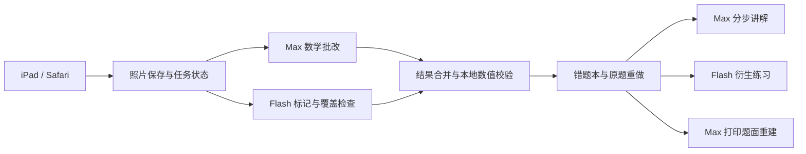

# 架构与模型流程

前端是 HTML、CSS 和 JavaScript，提供 PWA、照片预处理、草稿、练习和打印预览。Python 后台处理家庭会话、任务、SQLite、照片、模型调用与同步。一个 `app/` 目录包含完整产品，知识卡按主题组织。

主流程按题目逐步发布结果，前端读取任务进度。模型输出 JSON，后台校验结构和可验算表达式。数值校验能检查算式与答案是否一致，不能证明题意理解、老师标记识别或讲解全部正确。

原图和处理结果保存在私有目录，学习记录、每日温习和奖励按现有同步与去重规则保存。奖励由后台记账，兑换由家长确认。

阶段模型配置见 `app/server.py` 的 `stage_config`。知识内容位于 `app/curriculum/curriculum.json` 与 `app/dist/curriculum.js`，知识 ID 用于练习和错题关联。当前以单个家庭学习空间为单位，不提供班级租户或商业支付。
